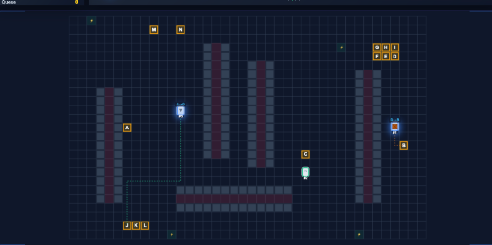

<div align="center">

# 🤖 AGV Smart Warehouse Dispatching & Simulation
### 智慧物流倉儲調度與路徑規劃模擬系統
### スマート物流・無人搬送車（AGV）シミュレーション
### 스마트 물류 AGV 창고 배차 및 경로 계획 시뮬레이션

[](LICENSE)
[](https://www.python.org/)
[](https://developer.mozilla.org/en-US/docs/Web/API/Canvas_API)
[](https://tailwindcss.com/)

<br>



<br><br>

**Language Selection / 語言選擇 / 言語選択 / 언어 선택:**  
[ 🇹🇼 繁體中文 ](#-繁體中文) • [ 🇺🇸 English ](#-english) • [ 🇯🇵 日本語 ](#-日本語) • [ 🇰🇷 한국어 ](#-한국어)

</div>

---

<br>

<h2 id="-english">🇺🇸 English</h2>

### Overview
A lightweight, modern, and interactive **Automated Guided Vehicle (AGV / AMR) Smart Warehouse Simulation System**. Built with Object-Oriented Programming (OOP), it demonstrates Multi-Agent Pathfinding (MAPF), single-track corridor mutex locking, A* heuristic navigation with turn penalties, and greedy task dispatching with battery constraints — all rendered in a smooth 60 FPS cyberpunk-style dashboard.

### 📌 Application Scenarios
1. **Algorithm & Data Structures Coursework**: Demonstrates practical applications of A* pathfinding (Min-Heap + turn penalty), BFS region scanning, Manhattan distance, and priority queues.
2. **Cap-Stone Projects & Demonstrations**: Features a 60 FPS real-time dashboard, live fleet telemetry, scrolling event logs, and 4 interactive algorithm modal cards.
3. **Smart Logistics Proof of Concept (POC)**: Simulates corridor deadlock avoidance, mutual exclusion locks, low-battery auto-recharge, and cargo load/unload workflows.

### 📂 File Structure
* **`index.html`**: Main interactive dashboard (Canvas 60 FPS animation, live fleet status, task board, event stream, and algorithm diagrams). Pure front-end, zero build dependencies.
* **`app.py`**: Python one-click server launcher. Starts Python's built-in HTTP server and automatically opens the browser.
* **`simulation.py`**: Pure Python algorithm implementation (`WarehouseMap`, `AStarPlanner`, `CorridorMutex`, `TaskDispatcher`, `AGV`).
* **`requirements.txt`**: Optional dependencies for Python data analysis.
* **`README.md`**: Project documentation with multilingual guides.
* **`.gitignore`**: Git filter rules excluding local environments and draft files.

### 🚀 Quick Start
* **Method 1: One-Click via Python (Recommended)**
  ```bash
  python3 app.py
  ```
  Automatically launches local server at `http://localhost:8080/index.html`.
* **Method 2: Direct Browser Launch**
  Double-click **`index.html`** in any modern web browser (Chrome, Safari, Edge). Fully offline-capable.

### 🧠 Core Algorithms
1. **Min-Heap**: Operates in $O(\log N)$ time to extract the lowest-cost node for A* search.
2. **A\* Heuristic Pathfinding**: Computes $f(n) = g(n) + h(n)$ using Manhattan distance, with a $+0.5$ turn penalty to encourage straight corridor transit.
3. **BFS Corridor Detection**: Scans the grid with BFS to group narrow passages flanked by shelves into mutex zones.
4. **Corridor Mutex Lock**: Single-track token system ensuring only one AGV occupies a narrow aisle at a time, preventing deadlocks.
5. **Greedy Task Dispatcher**: Evaluates $\text{Cost} = \text{Distance} + (100 - \text{Battery}) \times 2$ to assign jobs to the most suitable idle vehicle.

---

<br>

<h2 id="-繁體中文">🇹🇼 繁體中文</h2>

### 專案簡介
一個輕量、現代且直覺的**無人搬運車 (AGV / AMR) 智慧倉儲調度與路徑規劃模擬系統**。本專案透過物件導向架構 (OOP) 實作了多智慧體路徑規劃 (MAPF)、通道互斥鎖避死鎖、啟發式 A* 尋路與最佳化派工等經典演算法，並提供 60 FPS 流暢的深色科技風視覺化儀表板。

### 📌 適用情境
1. **演算法與資料結構課程作業**：示範 A* 尋路（結合最小堆積 Min-Heap 與轉彎懲罰）、BFS 區域擴散掃描、曼哈頓啟發式函數及優先權佇列的實際應用。
2. **大學專題 / 高中科技專案展示**：具備完整動態視覺化效果、即時車隊監控表格、滾動事件日誌與 4 大演算法互動圖解彈窗，適合報告與專案發表。
3. **自動化物流概念驗證 (POC)**：模擬無人搬運車在狹窄走廊中的避讓、互斥鎖申請、低電量自動返航回充、貨物裝卸排程等核心業務邏輯。

### 📂 檔案結構說明
* **`index.html`**：主要視覺化儀表板。純前端單檔即可執行（60 FPS Canvas 動畫、車隊狀態表、任務看板、事件日誌與演算法教學彈窗）。代碼含詳細雙語註解，無構建依賴。
* **`app.py`**：Python 一鍵伺服器啟動器。以 Python 內建 HTTP 伺服器啟動服務並自動開啟瀏覽器。
* **`simulation.py`**：純 Python 演算法實作核心（`WarehouseMap`, `AStarPlanner`, `CorridorMutex`, `TaskDispatcher`, `AGV`），適合演算法繳交或後端測試。
* **`requirements.txt`**：Python 套件依賴清單。
* **`README.md`**：專案說明、教學與演算法技術文件。
* **`.gitignore`**：Git 忽略規則（過濾虛擬環境、暫存檔與原始草稿）。

### 🚀 快速上手教學
* **方法一：使用 Python 一鍵啟動 (推薦)**
  ```bash
  python3 app.py
  ```
  系統會自動在背景啟動本地伺服器，並於預設瀏覽器中開啟 `http://localhost:8080/index.html`。
* **方法二：直接點擊開啟**
  使用 Chrome、Edge 或 Safari，直接雙擊打開 **`index.html`** 檔案即可完整運作（完全離線可用）。

### 🧠 核心演算法原理
1. **Min-Heap 最小堆積**：排隊時永遠讓數字最小的人站最前面，以 $O(\log N)$ 時間快速取出最優節點。
2. **A\* 最短路徑搜尋**：公式 $f(n) = g(n) + h(n)$，以曼哈頓距離為指南針，並加入轉彎懲罰（$0.5$）減少車輛扭動。
3. **BFS 狹窄通道識別**：以廣度優先搜尋掃描地圖，將被貨架包夾的走廊自動編列為同一區域 ID。
4. **單線通道互斥鎖 (Mutex)**：如單線鐵路橋信號燈，同一時間僅容一車進入，徹底杜絕死鎖與對撞。
5. **最佳化貪婪派工系統**：計算 $\text{總成本} = \text{距離} + (100 - \text{電量}) \times 2$，優先指派就近且電量充足的車輛。

---

<br>

<h2 id="-日本語">🇯🇵 日本語</h2>

### 概要
軽量かつインタラクティブな**無人搬送車（AGV / AMR）スマート倉庫配車・経路計画シミュレーションシステム**です。オブジェクト指向設計（OOP）に基づき、マルチエージェント経路計画（MAPF）、単線通路のミューテックス排他制御、旋回ペナルティ付き A* 探索、バッテリー制約付き最適配車アルゴリズムを実装し、60 FPS の洗練されたサイバーパンク風ダッシュボードで可視化します。

### 📌 活用シナリオ
1. **アルゴリズム・データ構造の課題・研究**：二分ヒープ（Min-Heap）による A* 探索、幅優先探索（BFS）による通路検出、マンハッタン距離ヒューリスティックの実装学習。
2. **大学・高専・高校の卒業研究・展示**：60 FPS の滑らかなアニメーション、フリート監視テーブル、リアルタイムログ、アルゴリズム解説モーダルを備え、プレゼンテーションに最適。
3. **スマート物流の概念実証（PoC）**：狭小通路でのすれ違い退避、デッドロック防止、バッテリー低下時の自動充電、荷物積み下ろしシーケンスの動作検証。

### 📂 ファイル構成
* **`index.html`**：メインダッシュボード（Canvas 60 FPS アニメーション、フリート状態表、イベントログ、解説モーダル）。外部ビルド不要の完全スタンドアロン構成。
* **`app.py`**：Python ワンクリック起動スクリプト。組み込み HTTP サーバーを起動しブラウザを自動オープン。
* **`simulation.py`**：純粋な Python によるアルゴリズム実装コア（`WarehouseMap`, `AStarPlanner`, `CorridorMutex`, `TaskDispatcher`, `AGV`）。
* **`requirements.txt`**：Python 依存パッケージ一覧。
* **`README.md`**：多言語対応のプロジェクト解説ドキュメント。
* **`.gitignore`**：Git 除外設定（仮想環境、一時ファイル等の除外）。

### 🚀 クイックスタート
* **方法 1：Python で一発起動（推奨）**
  ```bash
  python3 app.py
  ```
  ローカルサーバーが起動し、自動的に `http://localhost:8080/index.html` が開きます。
* **方法 2：ブラウザで直接起動**
  **`index.html`** をダブルクリックするだけで、モダンブラウザ（Chrome, Edge, Safari）上で即座に実行可能です（完全オフライン対応）。

### 🧠 コアアルゴリズムの解説
1. **最小ヒープ（Min-Heap）**：探索候補の中で最小コストのノードを $O(\log N)$ の高速さで取得。
2. **A\* 探索アルゴリズム**：マンハッタン距離を用いた $f(n) = g(n) + h(n)$ に加え、直線通路を優先する旋回ペナルティ（$+0.5$）を採用。
3. **BFS 通路自動識別**：棚に挟まれた狭小通路を幅優先探索でスキャンし、一意のエリア ID を付与。
4. **通路ミューテックス（Mutex Lock）**：単線鉄道の信号機のように動作し、通路内への同時進入を防ぎデッドロックを完全に排除。
5. **最適貪欲配車システム**：$\text{コスト} = \text{距離} + (100 - \text{バッテリー}) \times 2$ により、最短距離かつ充電十分な車両へ自動アサイン。

---

<br>

<h2 id="-한국어">🇰🇷 한국어</h2>

### 프로젝트 개요
가볍고 현대적인 **무인 운반차 (AGV / AMR) 스마트 물류 창고 배차 및 경로 계획 시뮬레이션 시스템**입니다. 객체 지향 프로그래밍(OOP) 기반으로 다중 에이전트 경로 탐색(MAPF), 단선 통로 상호 배제(Mutex) 데드락 방지, 회전 페널티를 적용한 A* 휴리스틱 경로 탐색, 배터리 잔량을 고려한 최적 배차 알고리즘을 구현하였으며, 60 FPS의 매끄러운 다크 테마 대시보드로 시각화합니다.

### 📌 활용 시나리오
1. **알고리즘 및 자료구조 과제/학습**：최소 힙(Min-Heap) 기반 A* 탐색, 너비 우선 탐색(BFS) 영역 확장, 맨해튼 거리 휴리스틱의 실전 응용 학습.
2. **대학 졸업 프로젝트 및 과학 전시**：60 FPS 실시간 캔버스 시뮬레이션, 차량 관제 테이블, 실시간 이벤트 로그, 알고리즘 팝업 카드를 포함하여 발표에 최적화.
3. **스마트 물류 PoC (개념 검증)**：좁은 통로에서의 양보 주차, 교착 상태(Deadlock) 방지, 저배터리 자동 충전 복귀, 상/하차 프로세스 검증.

### 📂 프로젝트 파일 구조
* **`index.html`**：메인 시각화 대시보드 (Canvas 60 FPS 애니메이션, 차량 관제표, 작업 보드, 이벤트 로그, 알고리즘 모달 포함). 빌드 도구 없이 즉시 실행 가능.
* **`app.py`**：파이썬 원클릭 서버 실행기. 내장 HTTP 서버를 구동하고 브라우저를 자동 실행.
* **`simulation.py`**：순수 파이썬 알고리즘 코어 (`WarehouseMap`, `AStarPlanner`, `CorridorMutex`, `TaskDispatcher`, `AGV`).
* **`requirements.txt`**：파이썬 패키지 의존성 목록.
* **`README.md`**：다국어 지원 프로젝트 설명서.
* **`.gitignore`**：Git 추적 제외 설정 파일.

### 🚀 빠른 시작 (Quick Start)
* **방법 1: 파이썬으로 원클릭 실행 (권장)**
  ```bash
  python3 app.py
  ```
  로컬 서버가 실행되며 브라우저에서 `http://localhost:8080/index.html`이 자동으로 열립니다.
* **방법 2: 브라우저로 직접 실행**
  크롬, 사파리, 엣지 등의 브라우저에서 **`index.html`** 파일을 더블 클릭하여 바로 실행 (완전 오프라인 동작 가능).

### 🧠 핵심 알고리즘 원리
1. **최소 힙 (Min-Heap)**：항상 가장 비용이 적은 노드를 $O(\log N)$ 시간에 추출하여 A* 탐색 속도를 극대화.
2. **A\* 경로 탐색 알고리즘**：맨해튼 거리를 활용한 $f(n) = g(n) + h(n)$ 공식에 직진 통로 주행을 유도하는 회전 페널티($+0.5$) 추가.
3. **BFS 좁은 통로 자동 식별**：너비 우선 탐색(BFS)을 통해 선반으로 둘러싸인 통로를 자동 인식하고 고유 구역 ID 부여.
4. **통로 뮤텍스 락 (Mutex Lock)**：단선 철도 신호등처럼 좁은 통로에 한 번에 한 대의 차량만 진입하도록 통제하여 충돌 및 데드락 원천 차단.
5. **탐욕적 최적 배차 시스템**：$\text{비용} = \text{이동거리} + (100 - \text{배터리}) \times 2$ 수식을 통해 가장 가깝고 배터리가 넉넉한 차량에 작업 자동 배정.

---

<br>

## 📄 License (開源授權)
This project is open-sourced under the [MIT License](LICENSE).  
본 프로젝트는 MIT 라이선스에 따라 자유롭게 수정, 배포 및 학습용으로 사용할 수 있습니다.  
本プロジェクトは MIT ライセンスの下で公開されており、商用・非商用問わず自由にご利用いただけます。
